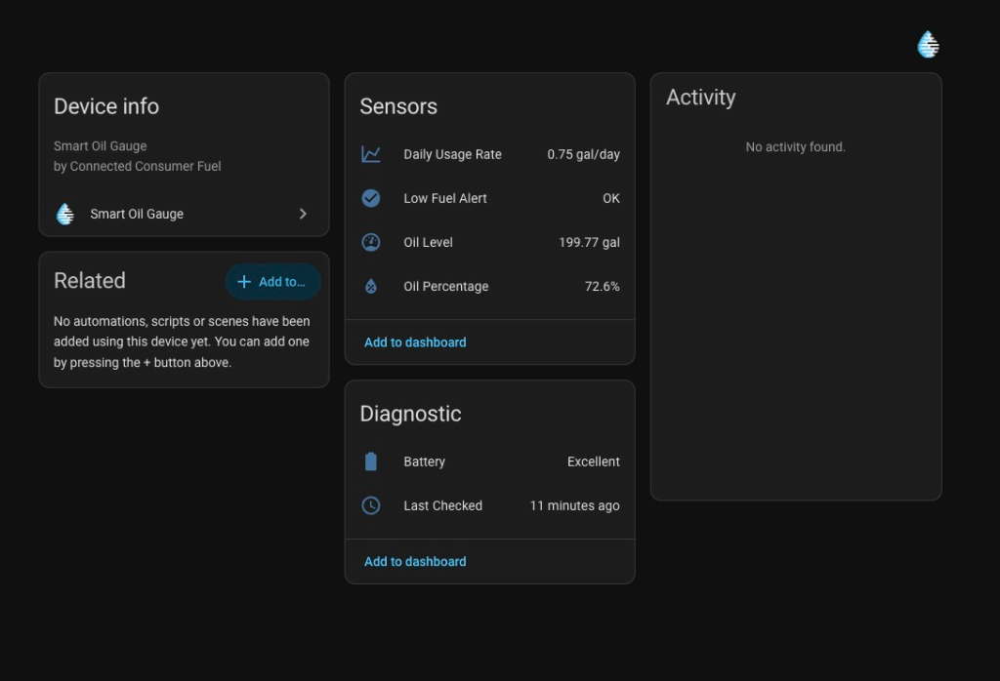

# Smart Oil Gauge for Home Assistant

See how much heating oil remains, track your tanks, and estimate when you may need a refill in Home Assistant.

## What can I do with it?

- See remaining gallons and tank percentage for each linked tank.
- Track estimated daily use, runout date, recent refills, and battery status.
- Build low-fuel alerts and dashboards using Home Assistant entities.
- Get reauthentication prompts and repair notices when portal access needs attention.

Runout dates and usage are estimates based on available data; check your tank and supplier information before relying on them.

## Requirements and compatibility

You need Home Assistant with HACS, a [Smart Oil Gauge portal account](https://app.smartoilgauge.com), and at least one tank already linked to that account. This integration reads the vendor portal over the internet; it supports multiple tanks on the same account.

## Install with HACS

1. In HACS, add `https://github.com/andrewtryder/ha-smart-oil-gauge` as a custom repository in the **Integration** category, or use the HACS badge above.
2. Find and install **Smart Oil Gauge**.
3. Restart Home Assistant.

For manual installation, download the latest release and copy `custom_components/smart_oil_gauge/` into your Home Assistant configuration's `custom_components` directory, then restart.

## First-time setup

1. Go to **Settings → Devices & services → Add integration** and select **Smart Oil Gauge**.
2. Enter your portal email and password and choose a polling interval from 1 to 24 hours. Six hours is recommended.
3. Submit the form. Each discovered tank appears as a device with its available sensors.

You can change the interval later in the integration's **Configure** options.

## What you'll see in Home Assistant

Depending on the data available, each tank can show level, percentage, daily usage, estimated runout date, refill information, capacity, battery health, and a low-fuel alert. See the [entity reference](docs/entities.md) for examples, and [dashboard examples](docs/dashboards.md) for ideas.

## Common problems and troubleshooting

- **No tank or stale reading:** check that the tank is linked and updated in the vendor portal. The physical gauge typically reports only one to three times per day; faster polling does not make its reading fresher and can cause rate limits or account blocks.
- **Authentication failed:** update the credentials when Home Assistant prompts for reauthentication.
- **Portal data cannot be read:** check Home Assistant repairs and diagnostics. Review diagnostics before sharing them and never post credentials.

## Limitations, safety, and privacy

The integration depends on the vendor's web portal and its available data. Oil level may be a physical reading or an estimate. Runout and daily-use values are estimates, not a guarantee of remaining fuel. A portal change or outage can interrupt updates.

Removing the integration through **Settings → Devices & services** also removes its locally stored refill history and related repair notifications; it does not change the vendor portal account.

## More documentation

- [Tank entities](docs/entities.md)
- [Energy and consumption tracking](docs/advanced-usage.md)
- [Dashboard examples](docs/dashboards.md)
- [Contributing](CONTRIBUTING.md) and [development](docs/development.md)

## Support and license

Report reproducible issues on [GitHub](https://github.com/andrewtryder/ha-smart-oil-gauge/issues). This is an unofficial community project, not an official Connected Consumer Fuel product. See the [license](LICENSE).
