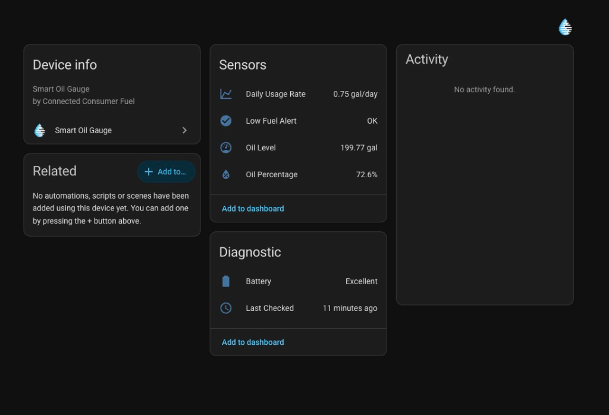

# Smart Oil Gauge for Home Assistant

See how much heating oil remains, track your tanks, and estimate when you may need a refill in Home Assistant.

## What can I do with it?

- See remaining gallons and tank percentage for each linked tank.
- Track estimated daily use, runout date, recent refills, and battery status.
- See every hourly reading in Home Assistant's history at the time it was taken, even though the gauge uploads them in batches (see [Hourly history](#hourly-history)).
- Build low-fuel alerts and dashboards using Home Assistant entities.
- Get reauthentication prompts and repair notices when portal access needs attention.

Runout dates and usage are estimates based on available data; check your tank and supplier information before relying on them.

## Requirements and compatibility

You need Home Assistant with HACS (or the built-in Home Assistant Marketplace in **2026.11+**), a [Smart Oil Gauge portal account](https://app.smartoilgauge.com), and at least one tank already linked to that account. This integration reads the vendor portal over the internet; it supports multiple tanks on the same account.

## Install with HACS or Home Assistant Marketplace

1. Click the **Open your Home Assistant instance** button above (backwards compatible: opens **HACS** on earlier versions and the built-in **Home Assistant Marketplace** on **2026.11+**), or manually add `https://github.com/andrewtryder/ha-smart-oil-gauge` as a custom repository in the **Integration** category.
2. Find and install **Smart Oil Gauge**.
3. Restart Home Assistant.

For manual installation, download the latest release and copy `custom_components/smart_oil_gauge/` into your Home Assistant configuration's `custom_components` directory, then restart.

## First-time setup

1. Go to **Settings → Devices & services → Add integration** and select **Smart Oil Gauge**.
2. Enter your portal email and password and choose a polling interval from 1 to 24 hours. Six hours is the default. Because missed hourly readings are filled in at their real times, a longer interval only delays when new readings appear; set it to 1 hour if you want uploads to show up sooner.
3. Submit the form. Each discovered tank appears as a device with its available sensors.

You can change the interval later in the integration's **Configure** options.

## Hourly history

The gauge takes a reading every hour but, to save battery, uploads them in batches (every 1–24 hours, set in the gauge's own configuration). Without help, Home Assistant only sees the newest reading at each upload, stamped with the time Home Assistant polled.

This integration fills in the gaps:

- **Last read** shows when the gauge actually uploaded, not when Home Assistant polled.
- **On every new upload** the hourly readings for the past week are fetched and written into Home Assistant's history **at the time each reading was taken**. The built-in history graph, the entity's more-info dialog, and the History panel all show the full hourly curve. Rows recorded between uploads that held a stale value are corrected to the true reading.
- **Long-term statistics** for the same hours are updated, so history older than the recorder's keep window (10 days by default) is also accurate.
- **On first setup** the gauge's full hourly history is downloaded from the portal's export and added: readings within the keep window as history, older readings as long-term statistics. Press **Import history** on the tank's device page to run it again; it is safe to repeat.
- **Refills** are detected from the hourly readings, so a slow refill (for example two tanks equalizing over many hours) is reported as one refill starting at its real time. **Last refill amount** has an `in_progress` attribute while the level is still climbing.

Both the history backfill and the first-time import can be turned off under **Configure**.

> **Note:** Home Assistant has no official API for writing past states, so the history backfill writes to the recorder database directly, using the recorder's own database models inside its own thread. It works with SQLite, MariaDB/MySQL, and PostgreSQL. If the recorder is migrating or its database layout is not what this version expects, the backfill is skipped with a warning and statistics are still updated. As with any database change, keep regular backups.

## What you'll see in Home Assistant

Depending on the data available, each tank can show level, percentage, daily usage, estimated runout date, refill information, capacity, battery health, and a low-fuel alert. See the [entity reference](docs/entities.md) for examples, and [dashboard examples](docs/dashboards.md) for ideas.

## Common problems and troubleshooting

- **No tank or stale reading:** check that the tank is linked and updated in the vendor portal. The physical gauge uploads only at its configured interval; polling more often than hourly does not make readings fresher. Missed hours are filled in automatically at the next upload.
- **Authentication failed:** update the credentials when Home Assistant prompts for reauthentication.
- **Portal data cannot be read:** check Home Assistant repairs and diagnostics. Review diagnostics before sharing them and never post credentials.

## Limitations, safety, and privacy

The integration depends on the vendor's web portal and its available data. Oil level may be a physical reading or an estimate. Runout and daily-use values are estimates, not a guarantee of remaining fuel. A portal change or outage can interrupt updates.

Removing the integration through **Settings → Devices & services** also removes its locally stored refill and backfill state and related repair notifications; history already written to the recorder stays until the recorder purges it. It does not change the vendor portal account.

## More documentation

- [Tank entities](docs/entities.md)
- [Energy and consumption tracking](docs/advanced-usage.md)
- [Dashboard examples](docs/dashboards.md)
- [Contributing](CONTRIBUTING.md) and [development](docs/development.md)

## Support and license

Report reproducible issues on [GitHub](https://github.com/andrewtryder/ha-smart-oil-gauge/issues). This is an unofficial community project, not an official Connected Consumer Fuel product. See the [license](LICENSE).
